# THIS IS HOW I MADE THIS PROJECT .

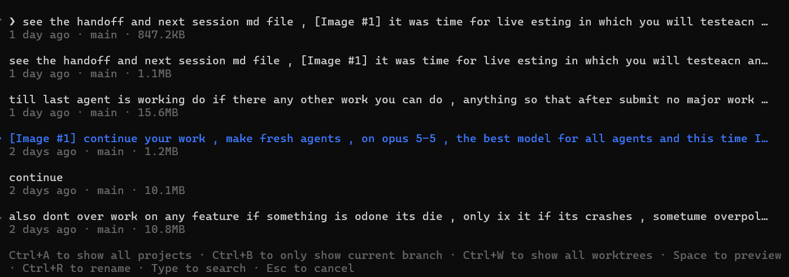
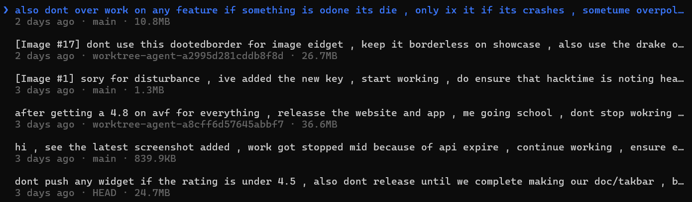
So this was not a small , one session project , so I had to make new sessions bcs of memory issue .
I made this because few days back I saw someone making a nothing ui for linux users . 
so I thought why not make for windows ?
so I opened my claude , asked him to do research about do ppl actually need something like this , made him scrap all the comments , divide in positive and negatives , what ppl liked , disliked. some things were common like -
1. Why not for windows?
2. a broken feature of it .
3. dock lacking with widgets .

So I decided to make something better and useful.
here are some screenshots of mine and claude conversations

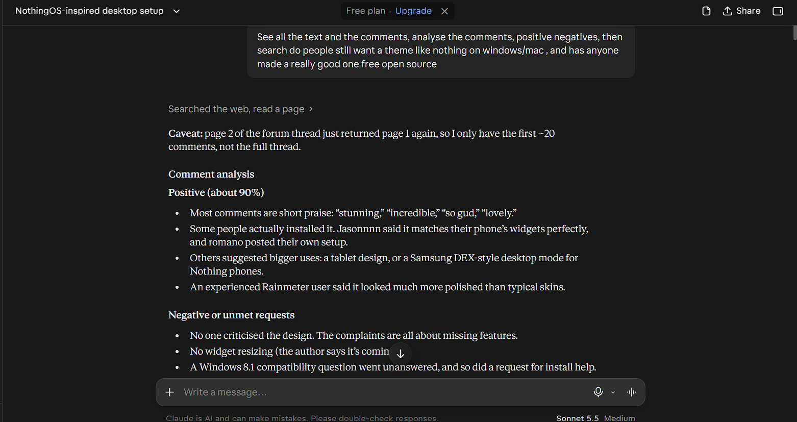
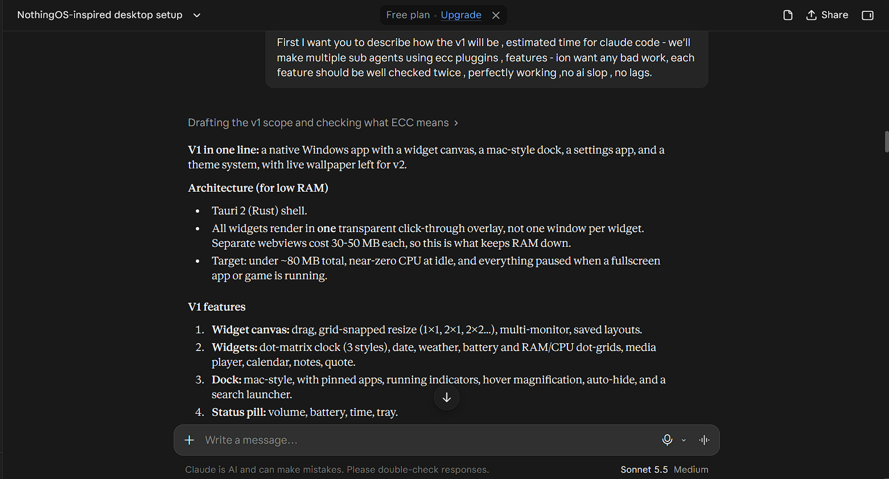

### now comes the building part 
tbh I dont know should I even prove how. I'll try
- I used opus 5-5 for the main agent in all sessions , sonnet 5-5 for the sub agents 

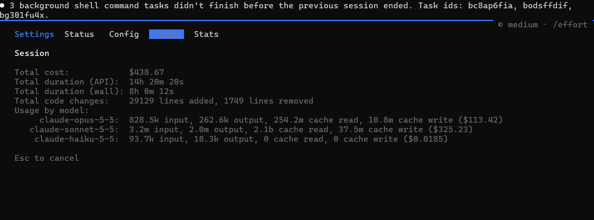 ~ this was the 2nd or 3rd session , when I had to test each and every small minute feature before claude can move to anything else , 
I run multiple sub agents to make the task a bit organised .
each agents worked on a separate branch and at the end main agent combined everything .

the thing which helped me alot in this and most of my ai projects is -https://github.com/affaan-m/ECC 
ts repo provides many pluggins and features and instructions. 

for designing the website
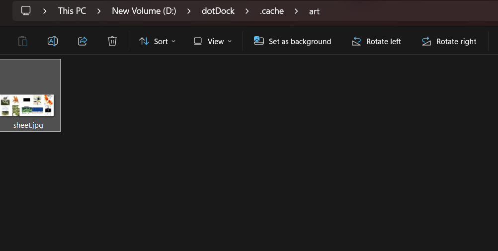
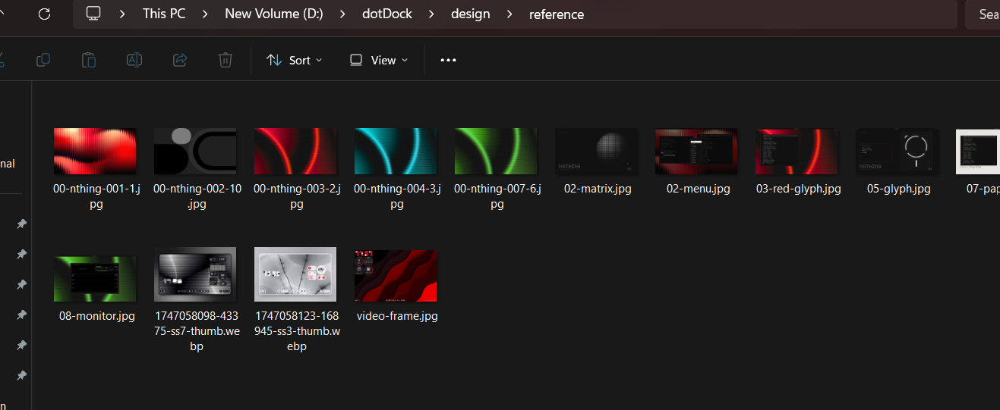
I added multiple images of design references from pinterest .

## how much time I spent?

according to hacktime ~
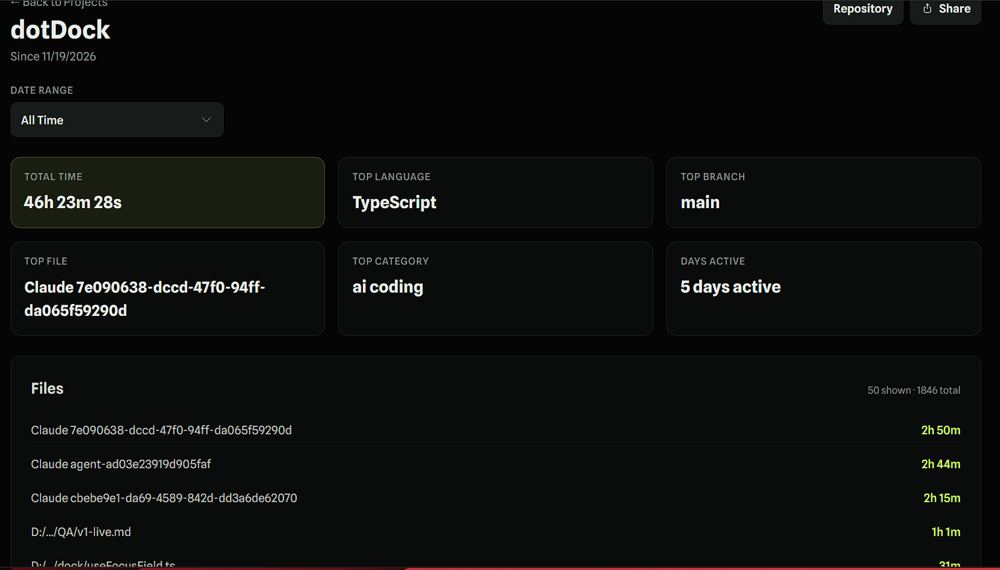

which is ofc not accurate , if you will calculate all sessions time its way more than that , I worked for whole day and till late night to make this , also I observed that it mostly tracks the time for the main agent and suddenly stops until fixed after every alternate hour .
I agree that claude also takes much time for thinking , researching , even if we remove that I have worked around 40~45 hrs 
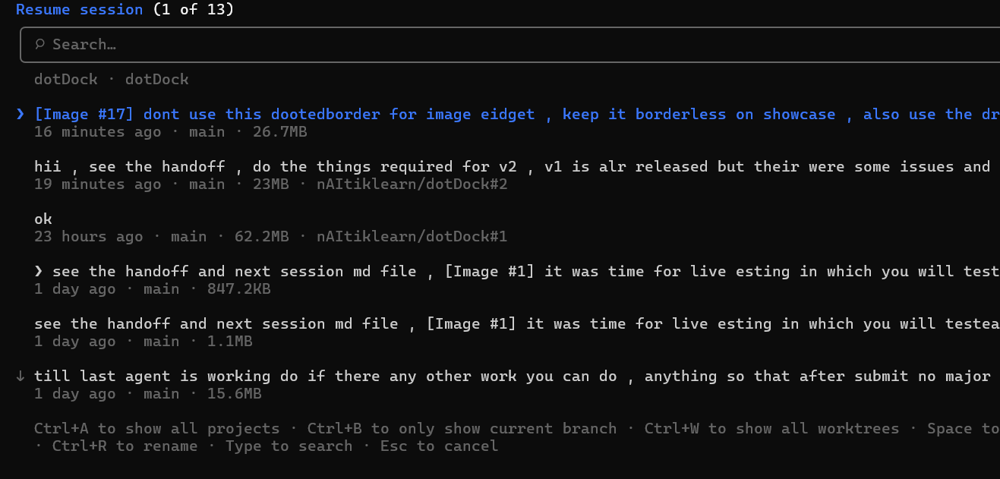
more than 50 sessions and most of them were pretty long enough 

adding screenshots of  each session usage -
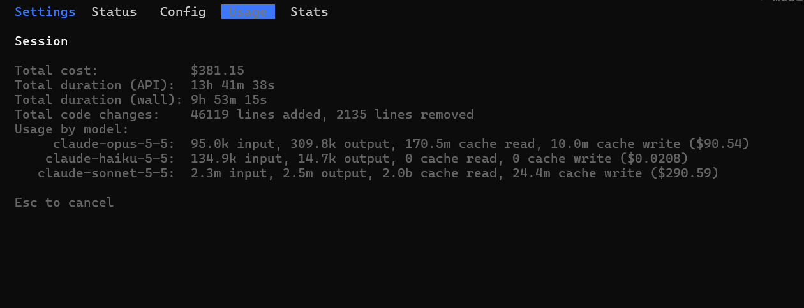
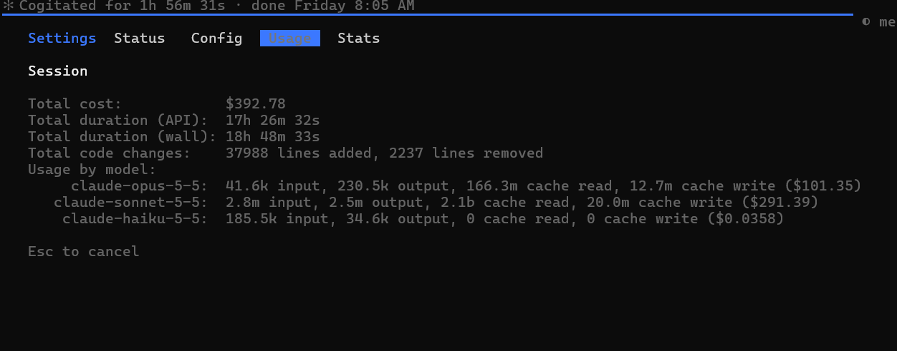
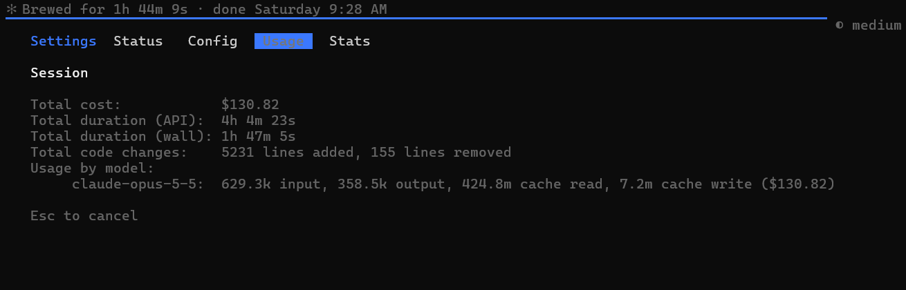
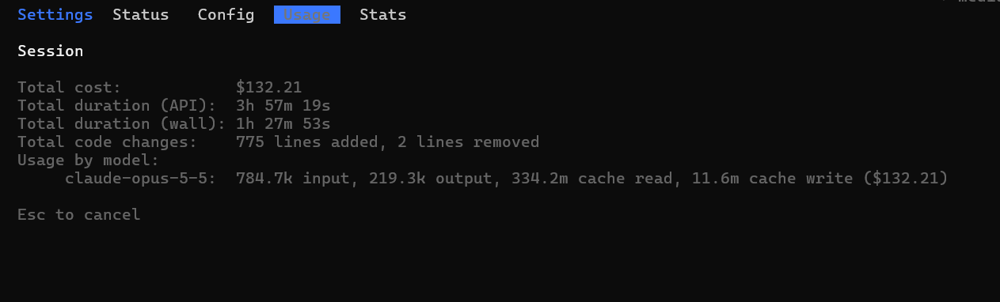
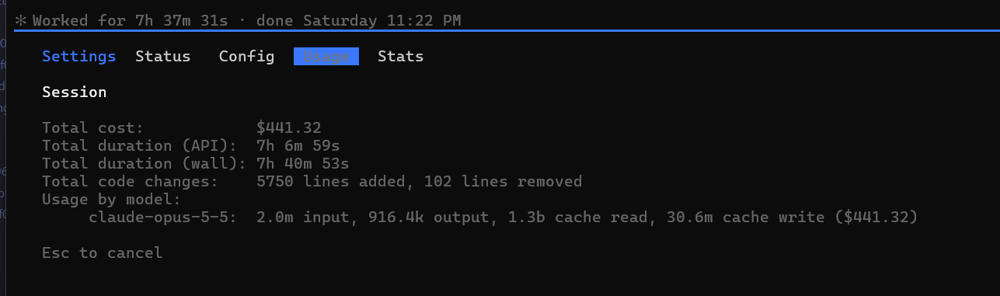
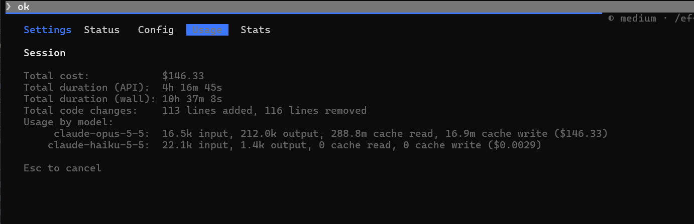
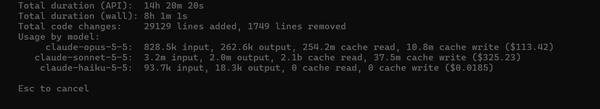

these were the main sessions , other than this , Ill just say , try the application , you will def see the efforts :)

PS- Got some good response too from ppl on the same day I launched it -

