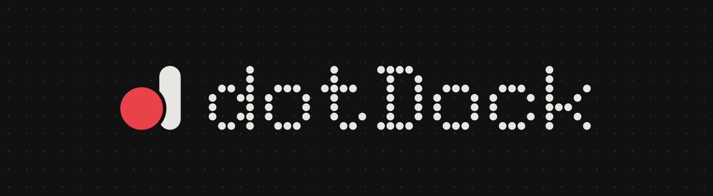
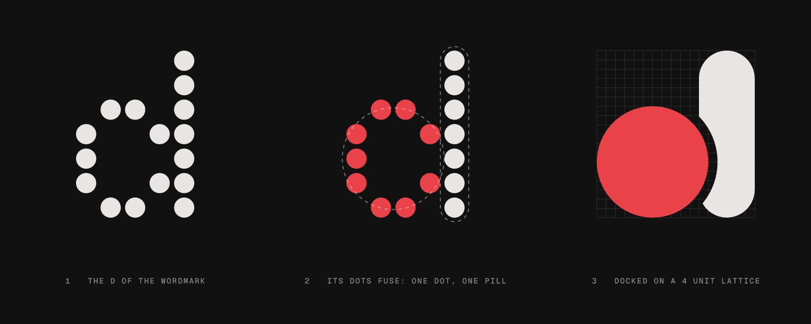
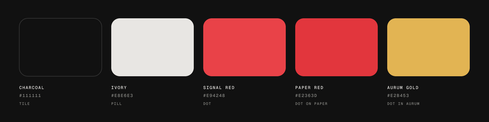
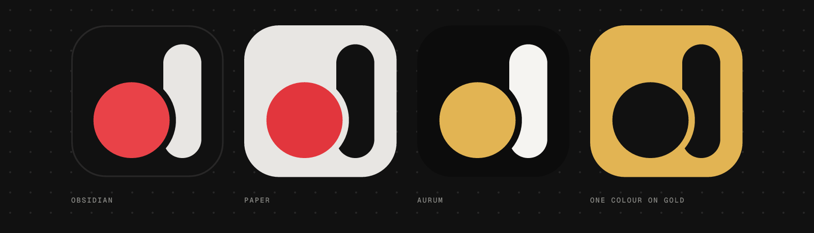
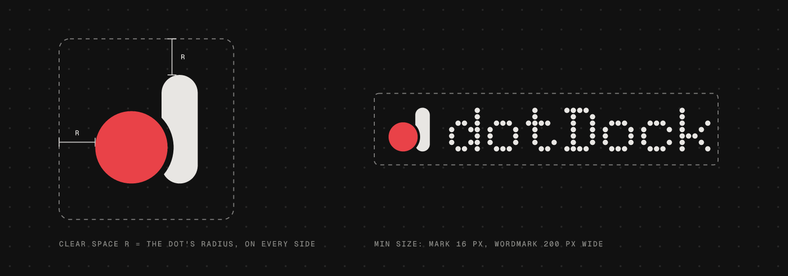
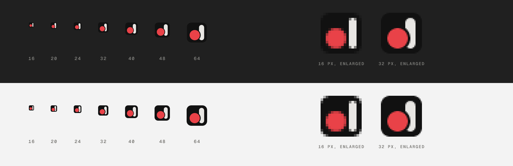
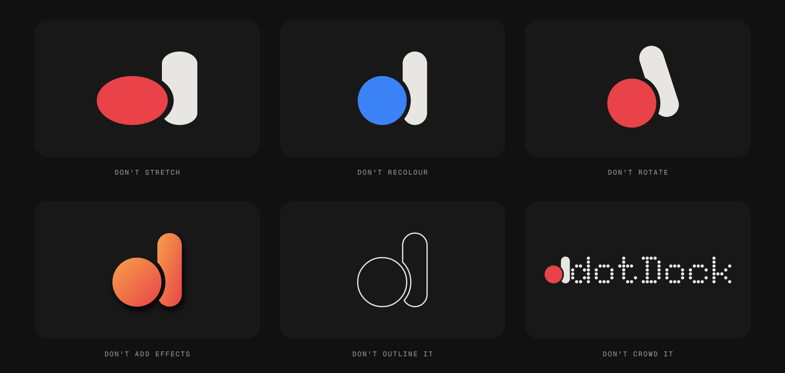

# dotDock brand



The mark is a dot docked in a pill. It reads as a lowercase **d**, for dot and for dock, and it is the
`d` of the wordmark with its dots fused: the bowl's dots become one dot, the stem's dots become one
pill. The dot sits in a socket cut from the pill, so the two never touch and never float apart.



The mark, the wordmark and every icon are original work, drawn from code in
[`tools/brand-gen`](../tools/brand-gen). The wordmark is set in Doto (SIL OFL 1.1). Nothing here
copies another product's logo, glyph set or typeface. dotDock is inspired by Nothing OS and is not
affiliated with or endorsed by Nothing Technology Limited.

## Files

| File | Use |
|---|---|
| `logo-mark.svg` | The app tile on charcoal. App stores, README badges, anything with a square slot. |
| `logo-mark-light.svg` | The same tile on paper, for light surfaces. |
| `logo-mark-mono.svg` | The bare mark as one path in `currentColor`. Print, engraving, stamps, one-colour UI. |
| `wordmark.svg` | Mark and name side by side, for dark surfaces. Transparent background. |
| `wordmark-light.svg` | The same for light surfaces. |
| `logo-mark-512.png` | The tile as a PNG. |
| `social-preview.png` | 1280 x 640, for the GitHub repository's social preview. |
| `exploration/` | The ten concepts and the variations behind the final mark. |

The app icons in `apps/desktop/src-tauri/icons`, the website favicon and `website/src/components/Mark.astro`
are generated from the same geometry. Do not edit them by hand: run the generator.

```
python -m venv .cache/venv
.cache/venv/Scripts/python -m pip install -r tools/brand-gen/requirements.txt
.cache/venv/Scripts/python -I tools/brand-gen/build.py
```

The product name is read from `apps/desktop/src/lib/branding.ts`. If it changes, run the generator and the
wordmark and social preview follow.

## Colour



Three colours carry the mark: charcoal for the tile, ivory for the pill, and one red for the dot. The dot
takes the accent of the theme it sits in (red in Obsidian and Paper, gold in Aurum), so the mark always
matches the desktop it is on. Never use more than one accent at a time.

| Pair | Contrast |
|---|---|
| Red dot on charcoal tile | 4.8 : 1 |
| Ivory pill on charcoal tile | 15.2 : 1 |
| Paper red dot on paper tile | 3.5 : 1 |
| Gold dot on Aurum black | 10.1 : 1 |

All pairs clear the 3 : 1 that WCAG asks of graphics. The tile alone is only 1.16 : 1 against a dark
taskbar, which is why the dot and the pill, not the tile, carry the identity at small sizes.



## Clear space and minimum size



Keep one dot radius (R) free on every side. The mark is legible down to 16 px; the wordmark down to 200 px
wide, below which its dots start to merge.

## Sizes



Below 48 px the mark is redrawn, not scaled. The 16, 20, 24 and 32 px drawings have whole-pixel edges and a
gap that stays one or two pixels wide; the 16 px drawing drops the socket, which would only smear. The
`.ico` carries a real drawing for 16, 20, 24, 32, 40, 48, 64, 128 and 256 px, and the tray asks Windows for
the small-icon size so it picks the matching one. A faint hairline keeps the dark tile visible on dark
taskbars from 48 px up.

## Do not



- Do not stretch, rotate, outline or add shadows and gradients.
- Do not recolour the dot or the pill outside the palette above.
- Do not set the name tight against the mark; use the lockup as supplied.
- Do not close the gap between the dot and the pill. The gap is part of the mark.
- Do not replace a letter of the name with the mark.
- Do not use the mark to suggest endorsement by, or affiliation with, any other product.

## Type

The name is Doto, a dot-matrix face by the Doto Project Authors (SIL OFL 1.1, `assets/web/fonts`). In
`wordmark.svg` every dot is an SVG circle on the font's lattice, so the file needs no font. On the
website the name is live text in the same face. Captions use Geist Mono; running text uses Geist.

## How it was chosen

Ten different ideas (a dock row of apps, a dot falling into a slot, a magnified dock, a ring and moon,
a hexagon of dots, a D-shaped tile, and others) were drawn at 256, 64, 32 and 16 px on dark, light, gold
and one colour. The docked `d` was the only one that stayed instantly readable at 16 px, worked in one
colour, and said both "dot" and "dock". The reasoning and the rejected concepts are in
[`docs/DECISIONS.md`](../docs/DECISIONS.md) D-019 and the sheets are in [`exploration/`](exploration).
